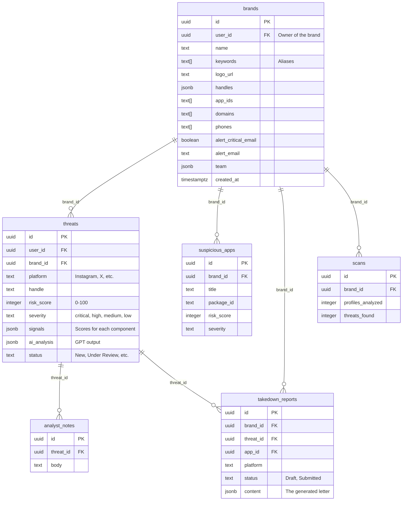

# SentinelX — Part 4: Database, Authentication, and AI

> This file answers: **Where is data stored? How do logins work? How does the AI connect?**

---

## 🗄️ Database: Supabase (PostgreSQL)

SentinelX uses a PostgreSQL database hosted by Supabase.

### Entity-Relationship Diagram



### Important Fields Explained

- `brands.handles`: Stored as a JSON object because platforms might change. e.g. `{"Instagram": "novapay", "X": "NovaPayIN"}`.
- `brands.team`: Stored as a simple JSON array of emails. **Note:** This does not create real user accounts for the team members.
- `threats.signals`: A JSON object holding the individual scores that made up the final risk score. Example: `{ handle: 80, logo: 94, ai: 76, account: 95 }`.
- `threats.ai_analysis`: The exact JSON object returned by the Lovable AI gateway.
- `takedown_reports.content`: A JSON object containing the formal letter text, evidence, and platform report link.

### Data Security: Row-Level Security (RLS)

This is the most critical security feature in the database.

Every single table in the database has a policy like this applied to it:

```sql
CREATE POLICY "Own rows select" ON public.threats 
FOR SELECT TO authenticated 
USING (auth.uid() = user_id);
```

**What this means:** When the frontend runs `supabase.from("threats").select("*")`, Supabase does NOT return all threats. It intercepts the query, looks at the JWT token sent with the request, extracts the `user_id`, and silently rewrites the query to `... WHERE user_id = '...'`.

This guarantees that a user from Brand A can never see threats belonging to Brand B, even if they try to hack the API request.

---

## 🔒 Authentication Flow

SentinelX uses Supabase Auth, which handles all password hashing and session management.

### The Login Sequence

1. **User Submits Form:** User types `alice@example.com` and password into the login form.
2. **Client Calls API:** `supabase.auth.signInWithPassword({ email, password })`.
3. **Supabase Verifies:** Supabase checks the password hash in its private auth schema.
4. **JWT Issued:** Supabase returns an `access_token` (a JWT — JSON Web Token).
5. **Local Storage:** The Supabase client automatically saves this JWT to the browser's `localStorage` (key: `sb-[project-ref]-auth-token`).
6. **Subsequent Requests:** Every time `supabase.from("threats").select()` is called, the client automatically adds `Authorization: Bearer <JWT>` to the HTTP headers.

### Route Protection

If a user tries to go directly to `http://localhost:3000/dashboard` without logging in, the `AuthLayout` component intercepts them:

```tsx
function AuthLayout() {
  const { session, loading } = useSession(); // Checks local storage for a valid JWT
  
  if (!loading && !session) {
    navigate({ to: "/auth" }); // Kicks them out
  }
  // ...
}
```

---

## 🤖 AI Integration

SentinelX integrates with Large Language Models (LLMs) to analyze suspicious accounts.

### The API Architecture

```
Frontend (Browser) 
  → POST to TanStack Server Function (`/api/analyzeScam`)
    → Validates user JWT 
    → POST to Lovable AI Gateway (`https://ai.gateway.lovable.dev`)
      → Routes to OpenAI (model: `gpt-6-astra`)
```

### Why Use a Gateway?
Instead of calling OpenAI directly, the code calls `ai.gateway.lovable.dev`. This allows Lovable to handle API keys, billing, and rate limiting for the generated application.

### The System Prompt

The AI acts under these instructions:

> "You are a brand-protection fraud analyst. Assess whether a social account or app impersonates the brand to scam customers. scam_probability is 0-1. indicators are short labels. scam_phrases are exact substrings copied from the text. explanation is 3-4 plain-English sentences. Respond in JSON."

### Structured Outputs (JSON Schema)

To ensure the AI doesn't return conversational text like "Here is the analysis...", the request forces a strict JSON schema:

```json
"response_format": {
  "type": "json_schema",
  "json_schema": {
    "name": "ScamAnalysis",
    "schema": {
      "type": "object",
      "properties": {
        "scam_probability": { "type": "number" },
        "indicators": { "type": "array", "items": { "type": "string" } },
        "scam_phrases": { "type": "array", "items": { "type": "string" } },
        "explanation": { "type": "string" }
      },
      "required": ["scam_probability", "indicators", "scam_phrases", "explanation"]
    }
  }
}
```

Because of this, the server function can safely parse the response (`JSON.parse(content)`) without defensive string-matching code.

### Error Handling

The server function anticipates specific AI-related errors:

```typescript
if (response.status === 429) {
  // 429 Too Many Requests
  throw new Error("AI is busy right now, try again in a moment.");
}
if (response.status === 402) {
  // 402 Payment Required
  throw new Error("AI credits are used up for this workspace.");
}
```

These errors are passed back to the frontend, which displays them in a red toast notification.
