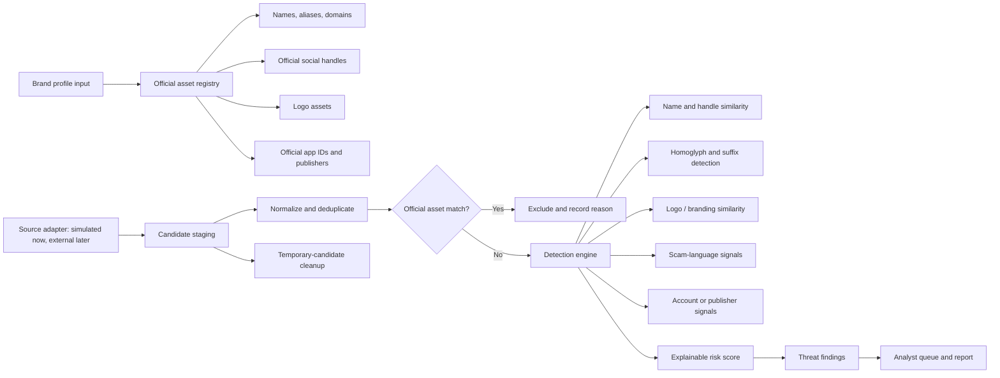

# Project Context: Digital Risk Protection — Social & App Monitoring

## Problem statement

Build a Digital Risk Protection platform that helps organizations identify and prioritize:

- Fake or impersonating social-media profiles and brand pages
- Scam accounts using a company identity
- Suspicious mobile apps impersonating a brand

The product must support a brand profile, social monitoring, app-store monitoring, explainable risk findings, and reporting. Look-alike name detection is a bonus requirement. The immediate target is a working prototype for the Kampus.VC challenge.

## Product decision

The current prototype must **not claim live crawling** of social networks or app stores. It should generate clearly labelled simulated candidates from the registered brand profile, then run the same exclusion, detection, scoring, storage, and reporting pipeline that future real source adapters will use.

When real sources become available, approved APIs, licensed data providers, or compliant collection adapters replace only the candidate-source layer; they do not change the downstream detection engine.

## Proposed architecture



## Required brand-profile data

The onboarding experience should collect:

- Brand/company name
- Brand aliases and matching keywords
- Official logo
- Official social handles, with platform mapping
- Official website domains
- Official mobile-app names and package/bundle IDs
- Approved developer or publisher names

Useful optional inputs include official support phone numbers, email domains, slogans, product names, and approved regional/agency accounts.

## Official-account exclusion rules

The brand profile is the source of truth. Before a candidate is risk-scored, exclude it if it has an approved:

- Platform + handle combination
- App package/bundle ID
- Canonical website domain
- Developer/publisher, where that developer is approved for the app

Persist the exclusion reason for auditability, but do not create a threat finding. This prevents the platform from flagging legitimate accounts and applications.

## Candidate generation for the MVP

Generate realistic but explicitly simulated social profiles and apps using the registered brand details. Every candidate must be marked `source_type = simulated` in storage and the UI.

Examples for a brand named `NovaPay`:

- `@n0vapay_support` — digit substitution plus a support suffix
- `@nоvapay.verify` — Cyrillic homoglyph plus verification pretext
- `@novapay_care_desk` — brand prefix plus a scam-oriented suffix
- `NovaPay Refund Helper` — similar app name plus a refund pretext
- `Nova Pay Wallet Lite` — spacing variation plus an untrusted publisher

A candidate requires enough evidence fields to be scored: platform/store, handle/title, display name, bio/description, avatar/icon or simulated logo-similarity value, account age, followers, verification state, developer/publisher, package ID, and requested permissions.

## Detection algorithm

Each non-excluded candidate receives independent 0–100 evidence signals:

```text
risk = round(
  0.30 * identity_similarity +
  0.25 * logo_similarity +
  0.30 * scam_content +
  0.15 * account_or_publisher_risk
)
```

Severity:

| Score | Severity |
| ---: | --- |
| 80–100 | Critical |
| 60–79 | High |
| 40–59 | Medium |
| 0–39 | Low |

### Identity / look-alike score — 30%

Normalize the candidate and official references before comparison:

1. Lowercase.
2. Remove spaces, punctuation, dots, hyphens, and underscores.
3. Normalize common swaps: `0 -> o`, `1 -> l`, `rn -> m`, `vv -> w`.
4. Map known Cyrillic/Greek look-alike characters to Latin equivalents.
5. Compare with normalized Levenshtein similarity:

```text
similarity = 1 - edit_distance(candidate, reference) / max(candidate_length, reference_length)
```

Add limited evidence for suspicious additions such as `support`, `care`, `help`, `official`, `refund`, `verify`, `kyc`, `helpline`, `desk`, and `team`, and for homoglyph use.

### Logo / branding score — 25%

For the MVP, this can be a deterministic simulated similarity value clearly labelled as simulated. Keep it separate from other signals so a future image hash or embedding service can replace it.

### Scam-content score — 30%

Use deterministic patterns to detect OTP/password requests, KYC lures, urgency/block/suspension claims, refund and payment-fee fraud, UPI/payment links, WhatsApp/phone diversion, short URLs, and screen-sharing lures. Optional AI can summarize evidence and extract exact phrases, but cannot replace deterministic exclusion or score calculation.

### Account / publisher score — 15%

Social indicators: new account, unverified status, very low followers, suspicious outbound link.

App indicators: unapproved developer, package ID mismatch, and high-risk permissions such as SMS, accessibility service, overlay, contacts, call logs, and install packages.

### Decision principle

Name similarity is never sufficient by itself to label a candidate fraudulent. High-priority findings should combine multiple signals; ambiguous records remain analyst-review findings.

## Existing project implementation

The current codebase already has a UI-driven scan simulator and rule-based scoring:

- `src/components/sx/ScanOverlay.tsx` runs the animated scan, creates a `scans` record, inserts discovered threats, and updates scan totals.
- `src/lib/demo-data.ts` defines `SCAN_POOL` and returns random selections through `scanDiscoveries`.
- `src/lib/scoring.ts` contains homoglyph normalization, Levenshtein similarity, suspicious-keyword flags, scam regexes, account signal scoring, weighted final score, and severity bands.
- `src/lib/ai.functions.ts` supports optional on-demand LLM re-analysis from a threat detail page.
- `drizzle/migrations/0000_migration.sql` defines the existing Supabase/PostgreSQL tables and RLS policies.

## Existing database schema

Current tables:

- `brands`: organization name, keywords, logo URL, handles, app IDs, domains, phones, settings, team
- `threats`: social findings, identity and scam signals, risk, severity, status, and AI analysis
- `suspicious_apps`: app findings, package ID, publisher, permissions, score, status, and AI analysis
- `takedown_reports`: report content connected to a threat or suspicious app
- `analyst_notes`: human-review notes connected to a threat
- `scans`: started/finished timestamps, profiles analyzed, and threats found

All existing tables use Supabase row-level security and are scoped to the authenticated `user_id`.

## Desired database lifecycle

Keep audit-worthy data. Do not delete the entire scan after report generation.

| Entity | Retention |
| --- | --- |
| Brand and official assets | Keep |
| Scan history | Keep |
| Exclusions and reasons | Keep or retain for audit |
| Threat/app findings | Keep |
| Reports and analyst notes | Keep |
| Raw/staged simulated candidates | Temporary; delete after configured retention |

Add `scan_candidates` for raw candidate staging and `scan_exclusions` for excluded official matches/reasons if the implementation needs explicit auditing. At scan completion, persist scan metadata, exclusions, findings, and reports; mark staged data processed; then clean only temporary candidate rows.

## Completed work

- Reviewed the current scan, scoring, data model, and optional AI-analysis implementation.
- Documented that the present scan is a demo simulation rather than live social/app-store monitoring.
- Defined a brand-driven simulated candidate strategy for the prototype.
- Defined official-asset exclusion rules and an explainable weighted score.
- Created GitHub issue [#1: Build an explainable Social & App Monitoring scan pipeline](https://github.com/abhinavsinghal-18/cosedion-10/issues/1) with architecture, algorithm, lifecycle, acceptance criteria, and demo script.

## Unresolved issues / risks

1. The current automatic scoring is hardcoded to `NOVAPAY_BRAND` references in `src/lib/demo-data.ts`, rather than the registered brand profile.
2. `SCAN_POOL` is hardcoded and does not derive fake candidates from user input.
3. The scan UI currently presents simulated platform progress/profile counts; it must clearly state `Simulated scan data`.
4. Logo similarity is currently a predefined demo value, not visual comparison.
5. A `scan_candidates` staging table and `scan_exclusions` audit table do not yet exist.
6. The app needs a clear source-status design for unavailable/rate-limited real sources.
7. No direct database connection configuration was available in the local checkout for inspecting actual hosted records; the authenticated application UI and Supabase project access are required.

## Next steps

1. Update onboarding/brand profile fields so they fully represent official identity assets.
2. Replace hardcoded NovaPay scoring references with the active brand's name, aliases, handles, domains, apps, and publishers.
3. Introduce a simulated candidate generator based on those brand values and mark its records as simulated.
4. Add official-asset exclusion before scoring, including a visible exclusion reason.
5. Add staging/audit lifecycle tables or equivalent metadata, then implement temporary-candidate cleanup without deleting findings or reports.
6. Make the results screen show a score breakdown and exact evidence for each candidate.
7. Implement the app-monitoring flow using the same candidate/exclude/score/report pipeline.
8. Add a source-health/unavailable state before integrating real external data sources.
9. Prepare the short demo: brand setup, official exclusion, homoglyph detection, suspicious-app detection, evidence review, and report generation.

## Important technical decisions

- Treat the MVP as simulated monitoring, not live web crawling.
- Preserve a source-adapter boundary for later compliant data integrations.
- Exclude official assets before threat scoring.
- Use deterministic, explainable rules for core scoring; use AI only as optional supporting analysis.
- Do not delete evidence, scan history, reports, or analyst actions during cleanup.
- Do not infer fraud from a similar name alone.
