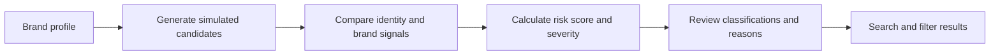
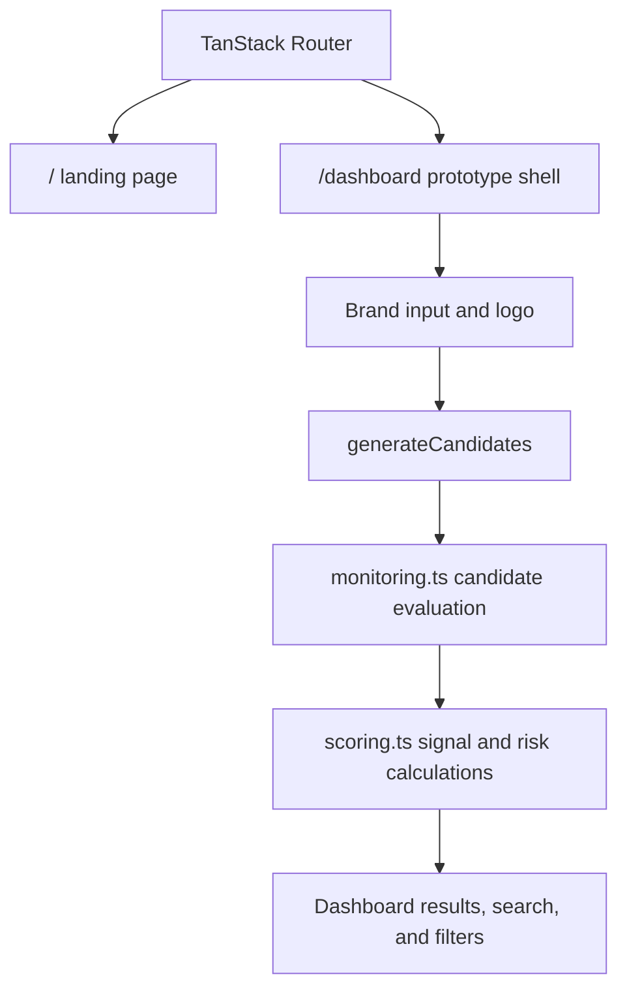

# Senttinelx

Senttinelx is a prototype digital risk protection dashboard for exploring how brand impersonation candidates can be identified and triaged. Add a brand profile, generate simulated social and app candidates, and inspect their risk scores and signals.

> **Prototype scope:** Candidate data is generated locally for demonstration. The app does not crawl live platforms, authenticate users, persist brand data, or submit takedown requests.

## How It Works

The landing page links to the dashboard at `/dashboard`. Enter a brand name and any available official handles, keywords, app IDs, or publishers. Generate candidates to see registered official assets alongside simulated look-alikes, scam profiles, and apps.



Candidate evaluation first checks registered official handles and app IDs. Other candidates are scored from identity similarity, simulated logo similarity, scam-language signals, and account or publisher risk. The weighted score is:

| Signal | Weight |
| --- | ---: |
| Handle and identity similarity | 30% |
| Logo similarity | 25% |
| Scam-content heuristic | 30% |
| Account or publisher risk | 15% |

Scores are mapped to labels: `80+` likely scam / critical, `60-79` high-risk impersonation / high, `40-59` potential impersonation / medium, and below `40` legitimate or benign / low. These are prototype heuristics, not verified threat intelligence.

## Application Flow



The dashboard keeps its current form, generated candidates, and filters in browser state. No server-side scan or database write is performed.

## Project Structure

| Path | Purpose |
| --- | --- |
| `src/routes/index.tsx` | Landing page and product overview |
| `src/routes/_authenticated/dashboard.tsx` | Brand input, candidate generation, and result controls |
| `src/routes/_authenticated/route.tsx` | Dashboard layout and app shell |
| `src/lib/monitoring.ts` | Simulated candidate creation and evaluation |
| `src/lib/scoring.ts` | Similarity, scam heuristics, weighted scores, and severity |
| `src/components/sx/` | Product UI, including the app shell and threat graph |
| `src/router.tsx` | TanStack Router setup |

## Development

Requires Node.js and npm.

```sh
npm install
npm run dev
```

Useful checks:

```sh
npm test
npm run lint
npm run build
```
