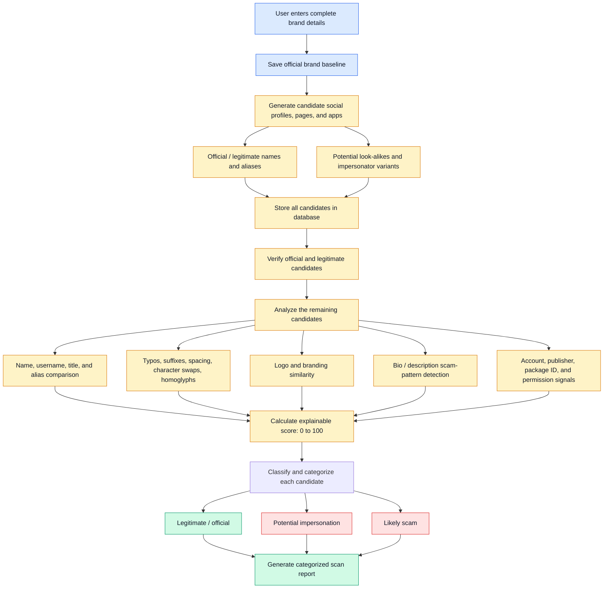

# 🛡️ Threat Lens

### AI-Assisted Digital Risk Protection

🚀 **Live Demo:** [Threat Lens](https://threat-lens-murex.vercel.app/)

Threat Lens is a digital risk protection platform designed to help identify potential brand impersonation, suspicious online identities, scam-related content, and potentially malicious applications.

The project aims to help organizations protect their digital identities through brand identity analysis, suspicious-content detection, and explainable risk scoring.

> **Project Status:** Prototype in active development. Some detection workflows use simulated data. Live social media discovery and production-grade AI analysis are planned improvements.

## 📌 Table of Contents

- [The Problem](#-the-problem)
- [Our Solution](#-our-solution)
- [Features](#-features)
- [How It Works](#️-how-it-works)
- [Risk Scoring](#-risk-scoring)
- [Technology Stack](#️-technology-stack)
- [Getting Started](#-getting-started)
- [Project Structure](#-project-structure)
- [Limitations](#️-limitations)
- [Roadmap](#-roadmap)
- [Contributing](#-contributing)
- [Disclaimer](#️-disclaimer)

---

## 🚨 The Problem

Online impersonation and digital scams can damage brand reputation and expose users to financial and privacy risks.

Examples include:

- Fake social media accounts impersonating legitimate companies.
- Fraudulent customer support and refund accounts.
- Messages requesting OTPs, payments, or sensitive information.
- Look-alike usernames designed to resemble official accounts.
- Suspicious applications claiming to represent trusted brands.

Investigating these threats manually can be time-consuming.

## 💡 Our Solution

Threat Lens aims to provide a centralized workspace for registering brand identities, analyzing suspicious candidates, assigning explainable risk scores, and managing investigations.

The long-term goal is to combine identity analysis, image comparison, authorized data collection, and AI-assisted investigation in one platform.

## ✨ Features

### 1. Brand Identity Management

Maintain reference information for a brand, including:

- Brand names and aliases.
- Official domains.
- Social media handles.
- Application identifiers.
- Approved publishers.
- Official identity references.

### 2. Identity Similarity Analysis

The scoring engine includes techniques such as:

- Username normalization.
- Levenshtein-based string similarity.
- Detection of selected look-alike characters.
- Suspicious keyword identification.

These techniques help identify candidate names that resemble registered brand identities.

### 3. Suspicious Content Detection

The current heuristic analyzer checks for patterns associated with potentially fraudulent messages, including:

- OTP and credential requests.
- Urgent account verification.
- KYC-related lures.
- Refund-related messages.
- Suspicious links and contact instructions.

These signals help prioritize investigations but do not prove fraud.

### 4. Risk Scoring

The system combines available signals into a risk score intended to help investigators prioritize candidates.

Potential signals include:

- Brand-name similarity.
- Logo similarity.
- Suspicious-content indicators.
- Account or publisher information.

Some signals may use simulated or manually supplied values in the current prototype.

### 5. Investigation Dashboard

The interface supports reviewing candidate records, inspecting risk indicators, and managing investigations.

### 6. Scan History and Reporting

The application includes investigation and reporting workflows, with persistence depending on the configured storage integration.

## ⚙️ How It Works

### 🏗️ System Architecture

The following architecture illustrates the intended Threat Lens workflow, from establishing an official brand baseline to analyzing potential impersonators and generating categorized investigation reports.



### Architecture Workflow

**1. Brand Baseline**

The user provides brand information, including official domains, aliases, social handles, application identifiers, approved publishers, and logo references.

**2. Candidate Generation**

The system is designed to collect or generate candidate identities, including legitimate accounts and potential look-alikes.

**3. Candidate Storage and Verification**

Candidate records are stored for analysis. Known official assets should be checked against reliable references before being classified as legitimate.

**4. Multi-Signal Analysis**

Candidates are evaluated using several signals:

- **Identity similarity:** Compare names, usernames, titles, and aliases.
- **Text normalization:** Detect typos, unusual suffixes, spacing variations, character substitutions, and homoglyphs.
- **Logo similarity:** Compare candidate branding against registered official logo references.
- **Scam-pattern detection:** Identify suspicious phrases and requests in bios or descriptions.
- **Account and application signals:** Examine available account metadata, publishers, package identifiers, and permissions.

**5. Explainable Risk Scoring**

Available signals contribute to a risk score between 0 and 100. The system should retain evidence explaining why a candidate received its score.

**6. Categorization and Reporting**

Candidates are grouped into categories such as legitimate / official, potential impersonation, and likely scam. Reports summarize the findings for human review.

> **Implementation Status:** This diagram represents the intended system architecture. Some current workflows use simulated candidate data, and automated live discovery, comprehensive verification, image-based logo comparison, and AI-assisted analysis require implementation and validation. The architecture should be updated as these capabilities become operational.

## 📊 Risk Scoring

Threat Lens assigns a risk score between 0 and 100 using available signals. The score helps users understand how suspicious a candidate account or application may be.

The scoring system considers:

- **Identity and handle similarity:** Similarities to official names and account identifiers.
- **Logo similarity:** Potential visual similarities to official branding.
- **Scam-pattern detection:** Suspicious phrases, misleading claims, and requests.
- **Account and application signals:** Available metadata, publisher information, package identifiers, and permissions.

Higher scores indicate greater potential risk. Scores should be treated as indicators for further investigation, not proof of fraud.

## 🛠️ Technology Stack

Threat Lens uses the following technologies in its project:

| Technology           | Purpose                                           |
| -------------------- | ------------------------------------------------- |
| React and TypeScript | Building the user interface and application logic |
| Vite                 | Development server and build tooling              |
| TanStack Start       | Application framework                             |
| Tailwind CSS         | Styling and responsive layouts                    |
| Supabase             | Backend and data-related services                 |
| Vitest               | Testing application code                          |

The exact functionality available depends on the current implementation and configuration.

## 🚀 Getting Started

### Prerequisites

Install the following before running the project:

- [Node.js](https://nodejs.org/)
- [Git](https://git-scm.com/)
- A code editor such as [Visual Studio Code](https://code.visualstudio.com/)

### Installation

**1. Clone the repository**

```bash
git clone https://github.com/Prashantm951/cosedion-10.git
```

**2. Enter the project directory**

```bash
cd cosedion-10
```

**3. Install dependencies**

```bash
npm install
```

**4. Start the development server**

```bash
npm run dev
```

Open the local URL displayed in your terminal.

Some features may require environment variables or backend configuration. Check the project's configuration before enabling those features.

## 📁 Project Structure

The main project files and directories include:

```text
cosedion-10/
├── public/             # Static assets
├── src/                # Application source code and components
├── package.json        # Dependencies and available scripts
├── README.md           # Project documentation
├── vite.config.ts      # Vite configuration
├── tsconfig.json       # TypeScript configuration
└── vitest.config.ts    # Vitest configuration
```

Additional files and directories may support formatting, linting, development, and application configuration.

The `.env` file, if required, should contain local environment variables and must not be committed if it contains secrets.

## ⚠️ Limitations

Threat Lens is under development. Its current limitations include:

- Some candidate account data may be simulated rather than collected from live platforms.
- Live discovery and comprehensive verification are not yet fully implemented.
- Logo comparison may require additional implementation and validation.
- AI-assisted analysis should not be considered operational unless explicitly integrated and tested.
- Risk scores can produce false positives and false negatives.
- A high score does not prove that an account or application is fraudulent.

Always verify suspicious accounts and applications through trusted official sources before taking action.

## 🗺️ Roadmap

Potential future improvements include:

- Implementing reliable live candidate discovery.
- Improving identity and impersonation detection.
- Integrating validated logo comparison.
- Adding explainable evidence for individual risk scores.
- Expanding automated tests and validation.
- Improving reporting and investigation workflows.
- Evaluating detection accuracy using representative test data.

Roadmap items are goals, not claims that these features are already available.

## 🤝 Contributing

Contributions are welcome.

1. Fork the repository.
2. Create a branch for your changes.
3. Make your changes and test them.
4. Commit your work with a clear message.
5. Open a pull request describing the changes.

Please avoid committing secrets, API keys, access tokens, or personal data. Keep documentation aligned with the actual implementation.

## ⚖️ Disclaimer

Threat Lens is intended to assist with identifying potentially suspicious accounts and applications. It does not guarantee the detection of every scam or impersonation attempt.

Risk scores and alerts are informational and should support, **not replace**, independent verification and sound judgment. Do not use the tool as the sole basis for financial, legal, or security-critical decisions.

The project is provided for educational and defensive purposes. Users are responsible for complying with applicable laws, platform policies, and privacy requirements.

**Live Demo:** [Threat Lens](https://threat-lens-murex.vercel.app/)
